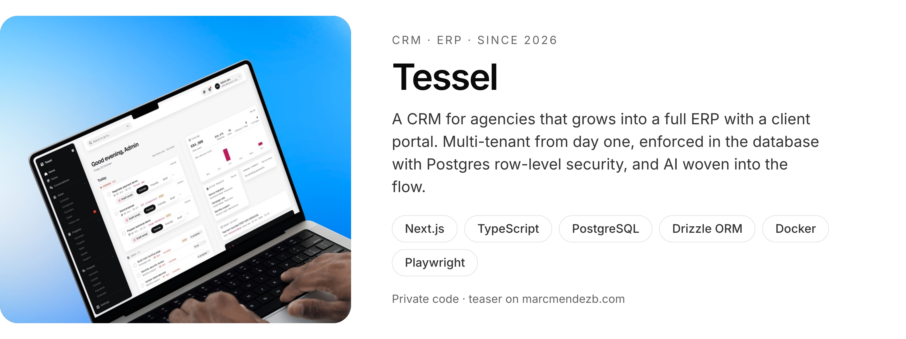
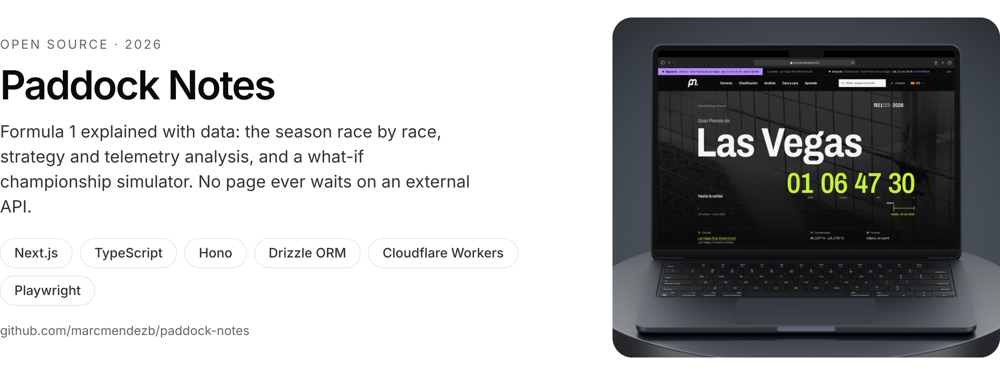
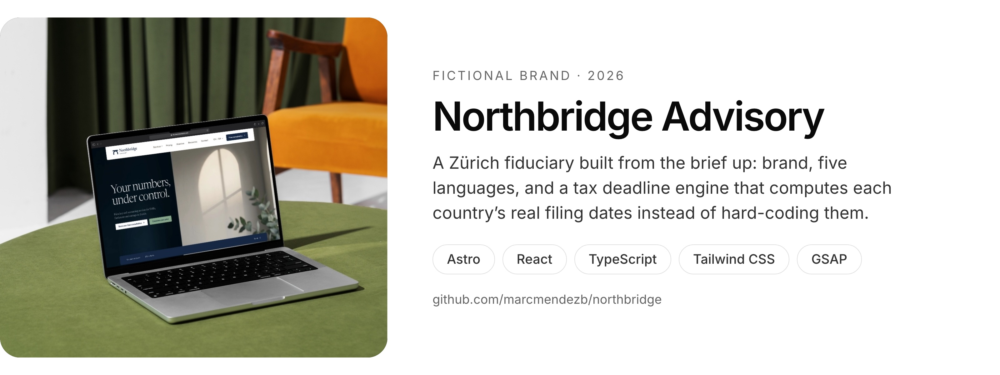
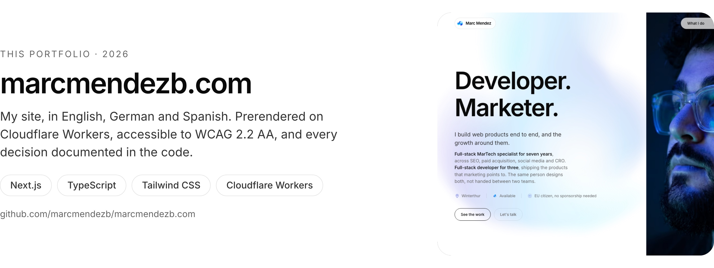
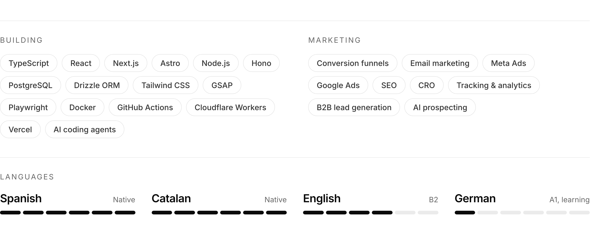
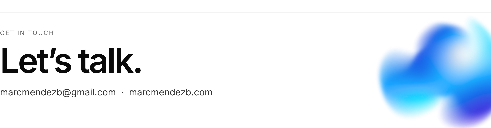

<a href="https://marcmendezb.com">
  <picture>
    <source media="(prefers-color-scheme: dark)" srcset="assets/header-dark.svg">
    
  </picture>
</a>

Seven years in marketing, three building products. I design the funnel and build the product, so the two are planned together instead of negotiated between teams.

**[marcmendezb.com](https://marcmendezb.com)** · **[LinkedIn](https://www.linkedin.com/in/marc-m%C3%A9ndez-barnils-53b5a4183/)** · **[marcmendezb@gmail.com](mailto:marcmendezb@gmail.com)**

 

## Selected work

<a href="https://marcmendezb.com/en/#work">
  <picture>
    <source media="(prefers-color-scheme: dark)" srcset="assets/project-tessel-dark.jpg">
    
  </picture>
</a>

<a href="https://github.com/marcmendezb/paddock-notes">
  <picture>
    <source media="(prefers-color-scheme: dark)" srcset="assets/project-paddock-notes-dark.jpg">
    
  </picture>
</a>

<a href="https://github.com/marcmendezb/northbridge">
  <picture>
    <source media="(prefers-color-scheme: dark)" srcset="assets/project-northbridge-dark.jpg">
    
  </picture>
</a>

<a href="https://github.com/marcmendezb/marcmendezb.com">
  <picture>
    <source media="(prefers-color-scheme: dark)" srcset="assets/project-site-dark.jpg">
    
  </picture>
</a>

[Tessel teaser](https://marcmendezb.com/en/#work) · [Paddock Notes](https://github.com/marcmendezb/paddock-notes) · [Northbridge](https://github.com/marcmendezb/northbridge) · [marcmendezb.com](https://github.com/marcmendezb/marcmendezb.com)

Most of my client work is private. The site shows more of it.

 

## What I work with

<picture>
  <source media="(prefers-color-scheme: dark)" srcset="assets/toolbox-dark.png">
  
</picture>

<a href="mailto:marcmendezb@gmail.com">
  <picture>
    <source media="(prefers-color-scheme: dark)" srcset="assets/contact-dark.jpg">
    
  </picture>
</a>
