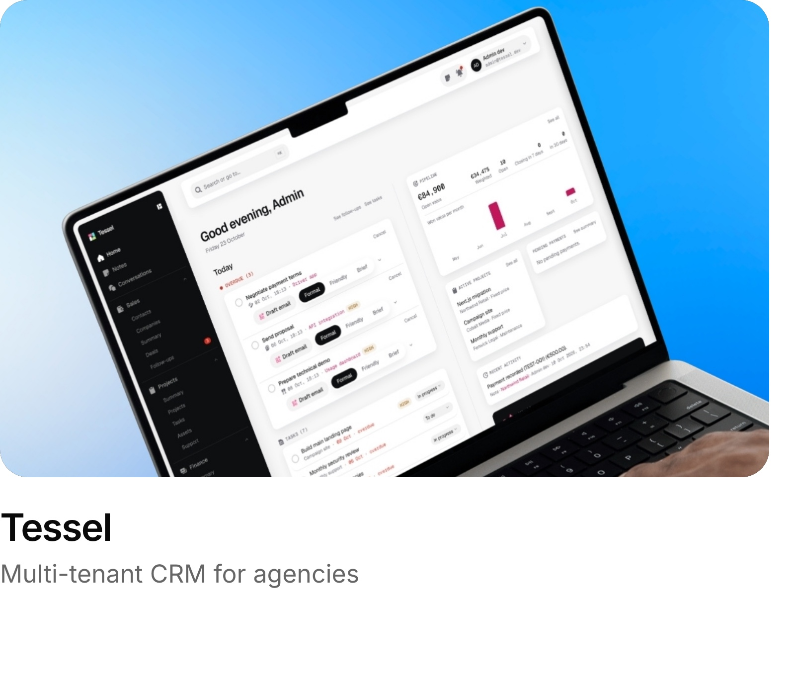
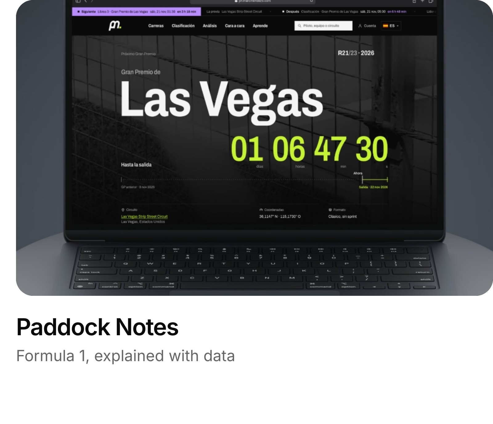
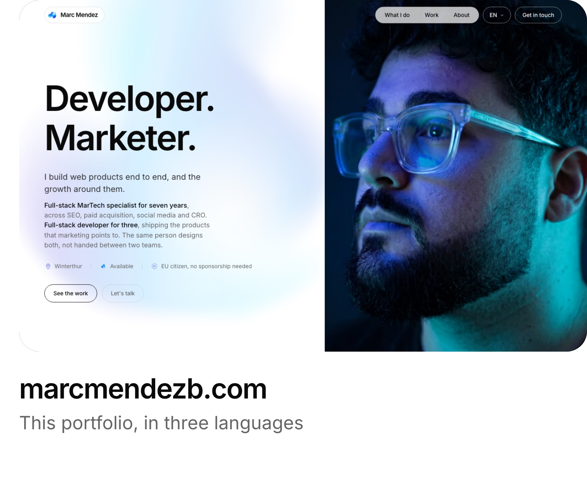
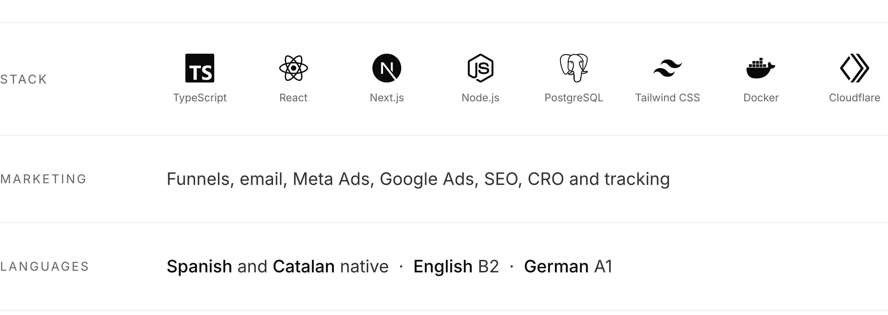
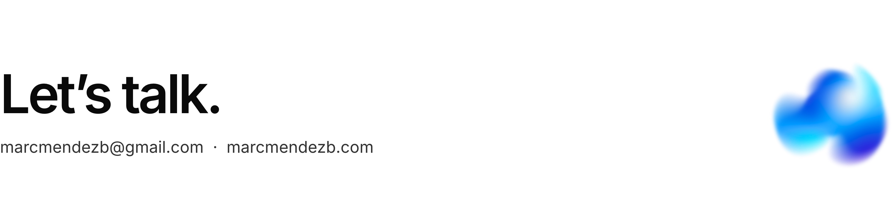

<a href="https://marcmendezb.com"><picture><source media="(prefers-color-scheme: dark)" srcset="assets/header-dark.svg"></picture></a>

 

<a href="https://marcmendezb.com/en/#work"><picture><source media="(prefers-color-scheme: dark)" srcset="assets/work-tessel-dark.jpg"></picture></a><a href="https://github.com/marcmendezb/paddock-notes"><picture><source media="(prefers-color-scheme: dark)" srcset="assets/work-paddock-notes-dark.jpg"></picture></a>
<a href="https://github.com/marcmendezb/northbridge"><picture><source media="(prefers-color-scheme: dark)" srcset="assets/work-northbridge-dark.jpg"></picture></a><a href="https://github.com/marcmendezb/marcmendezb.com"><picture><source media="(prefers-color-scheme: dark)" srcset="assets/work-site-dark.jpg"></picture></a>

<picture><source media="(prefers-color-scheme: dark)" srcset="assets/about-dark.png"></picture>

<a href="mailto:marcmendezb@gmail.com"><picture><source media="(prefers-color-scheme: dark)" srcset="assets/talk-dark.jpg"></picture></a>
